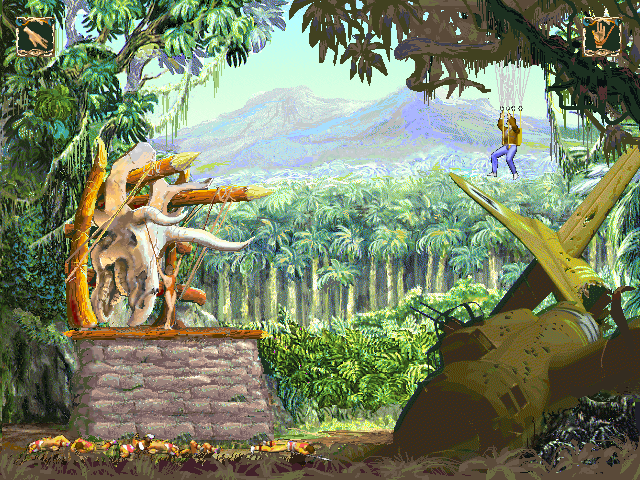
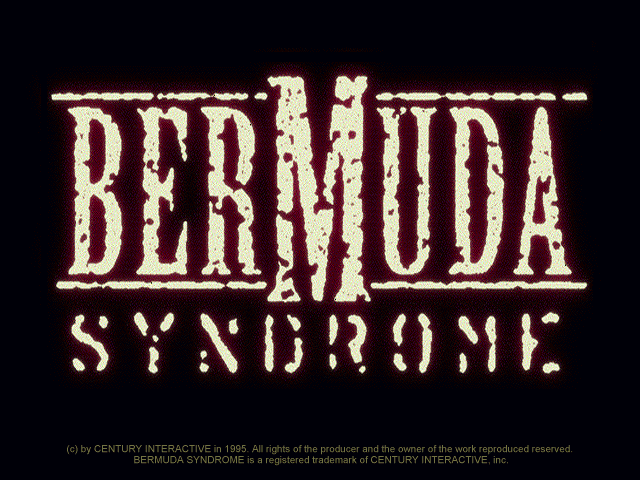
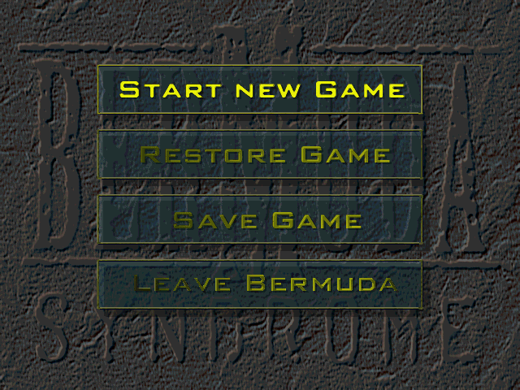

# Bermuda Syndrome — Static Recompilation

Static recompilation of **Bermuda Syndrome** (Century Interactive / BMG
Interactive, 1995), the Windows 3.1 cinematic platformer, from its shipping
16-bit (NE) executable to native C that runs as a Windows program: no
emulator, no Windows 3.1. `BERMUDA.EXE` is lifted by pcrecomp's NE front end
and runs on its Win16 host, which answers KERNEL, USER, GDI, MMSYSTEM and
COMMDLG with Win32; the videos and music go through MCI, which the host
forwards to Windows' own.

Built on the [pcrecomp](https://github.com/sp00nznet/pcrecomp) toolchain, on
its branch **`pcrecomp-ne-nativemap`** (the Win16 recomps' branch, not yet in
`main`), in the same layout as the [Space Bucks](https://github.com/sp00nznet/spacebucks-recomp)
and [Catz](https://github.com/sp00nznet/catz-recomp) recomps.

## Getting Started

You need **your own copy of Bermuda Syndrome**: the CD, a copy of its
`BERMUDA` folder, or an `.iso` of the CD. Nothing from the game is in this
repository or downloaded for you; everything is built on your machine from
your copy. There is no installer release yet.

### The setup script

1. Download this repository (the green **Code** button, then **Download ZIP**)
   and unzip it somewhere with 700 MB free.
2. Windows: double-click **`Setup.cmd`**.
3. Play with **`Bermuda Syndrome.cmd`** in that folder.

The script asks before installing anything (Python 3.10+ with `capstone`,
CMake, Ninja, MSYS2's MinGW-w64 gcc), fetches pcrecomp on branch
`pcrecomp-ne-nativemap` beside this folder if it is missing (an existing
checkout on another branch is left alone, and it tells you what to run),
finds the CD in your drives or asks where it is (`Setup.cmd -GameDir E:\`
or `-GameDir bermuda.iso`; `-Yes` answers yes to everything), then copies
the game into `game\`, lifts it and builds `build\bermuda.exe`. A rerun skips
finished steps; if it stops, it says why in one sentence and the details are
in `setup.log`. Building by hand is in **[docs/building.md](docs/building.md)**.

Linux and macOS: not yet. The host is a Win32 program built with MinGW, and
`./setup.sh` says so and exits.

On the title, click or press a key for the menu: Start, Restore, Save, Leave.
`INTRO=OFF` in `game\BERMUDA.INI` skips the two-minute intro video.

## Status

**v0.1.0, early alpha: it boots to the first scene of a new game.**

| Stage | State |
|---|---|
| Version recompiled | `BERMUDA.EXE` from the CD (145,920 bytes), 12 code segments (76 KB) |
| Lift (`tools/relift.py`) | 3,306 functions, 0 unresolved calls, with pcrecomp's own code map (no IDA) |
| Startup, `BERMUDA.INI`, the palette | run |
| Logo and intro videos (Cinepak via MCI) | play, then hand over to the game |
| Title screen and main menu | run, keyboard and mouse |
| New game: the jungle crash site, Jack on his parachute | draws and animates |
| Music (MIDI via MCI) | plays |
| Walking, fighting, dialogue, later scenes | not checked yet |
| Restore / Save (`GetOpenFileName` / `GetSaveFileName`) | stubbed |
| Headless mode, conformance harness | not yet; runs are checked by hand |

[docs/lifting.md](docs/lifting.md) is the log of each wall and its fix, and
[ROADMAP.md](ROADMAP.md) what comes next.

## Screenshots

Real output of `build\bermuda.exe`, recompiled code throughout:

| | |
|---|---|
|  |  |

## Documentation

- [docs/building.md](docs/building.md): building by hand, the toolkit branch, the usual trip-ups
- [docs/lifting.md](docs/lifting.md): getting the game off the CD, and every wall so far and its fix
- [ROADMAP.md](ROADMAP.md), [CHANGELOG.md](CHANGELOG.md), [CONTRIBUTING.md](CONTRIBUTING.md)

## Contributors

See **[CONTRIBUTORS.md](CONTRIBUTORS.md)** for who did what.

## License

MIT for this repository's own code ([LICENSE](LICENSE)). Bermuda Syndrome is
© 1995 Century Interactive; none of its files, and nothing generated from
them, is in this repository ([NOTICE.md](NOTICE.md)).
